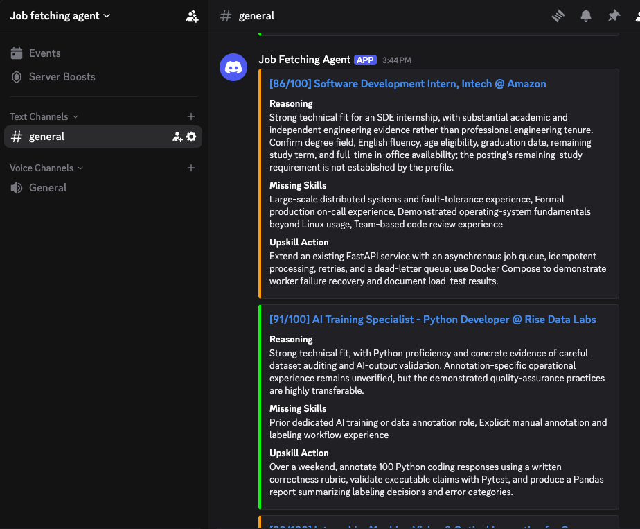
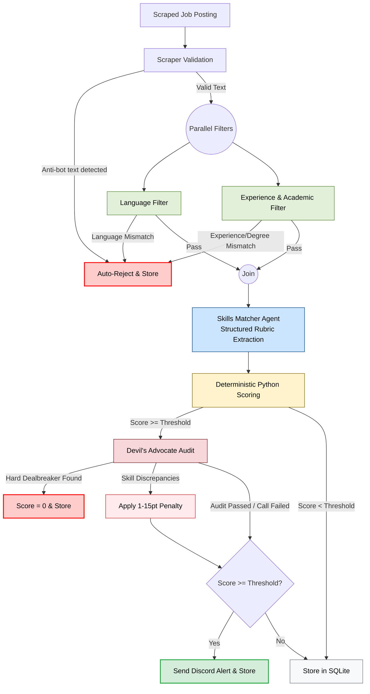
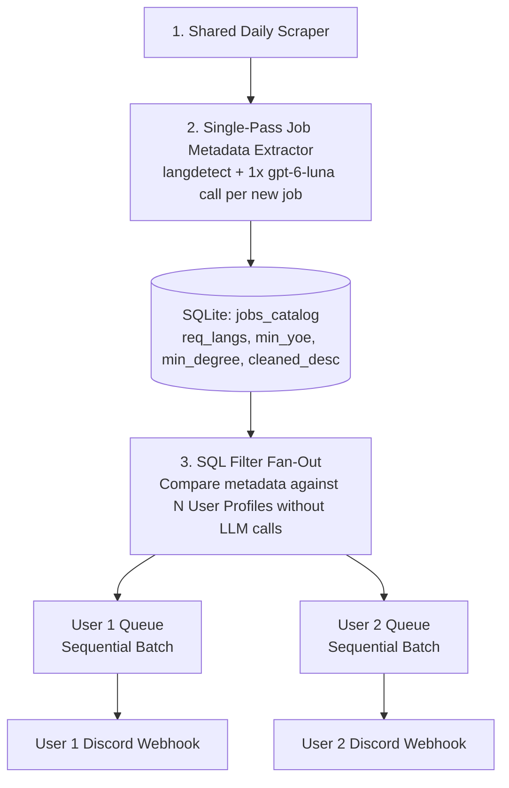

# AI Job Fetching Agent

A self-hosted job-discovery service that converts a CV into a structured candidate profile, evaluates scraped job postings, and sends matching opportunities to Discord. It combines concurrent eligibility checks, structured LLM rubric extraction, deterministic Python scoring, and persistent processing state.

> **Current Release Scope:** Single candidate profile and single application process. The scheduler, pipeline lock, and live status are process-local. Match scores are heuristic relevance ratings; model outputs and audit decisions remain model-dependent.

---

## Demonstration

When the multi-agent pipeline finds a relevant job that passes the language filter, experience gatekeeper, and reaches the configured score threshold, it formats a rich notification and sends a Discord webhook alert.



---

## Core Features

- **Automated Web Scraping:** Queries LinkedIn and Indeed via the `jobspy` library for targeted engineering titles and locations.
- **Concurrent Eligibility Filtering:** Runs fast spoken-language and experience/seniority checks concurrently in LangGraph before invoking the more expensive skills evaluator.
- **Structured Rubric Extraction:** Extracts concrete evidence (`matched_core_skills`, `missing_core_skills`, `missing_secondary_skills`, `project_relevance_bonus`, `hard_dealbreaker_found`) using Pydantic schemas.
- **Deterministic Python Scoring:** Computes the final match score in application code using fixed mathematical weights rather than relying on unreliable LLM arithmetic.
- **Devil's Advocate Audit:** Performs a secondary verification on roles meeting the match threshold to check for hallucinations and strict non-technical dealbreakers.
- **Persistent Processing State:** SQLite database tracks job statuses (`FILTERED_LANG`, `FILTERED_EXP`, `FILTERED_BOT`, `EVALUATED`, `ERROR_TRANSIENT`) with source ID and normalized fingerprint deduplication.
- **Containerized API & Tunnel Ready:** Fully dockerized FastAPI service with optional Cloudflare Tunnel configuration and API key authentication.

---

## Model Configuration

Model routing and provider fallbacks are managed centrally in `app/agent/llm_router.py` using `litellm.Router`:

| Pipeline Role | Primary Model Alias | Fallback Model Alias | Provider | Purpose |
|---|---|---|---|---|
| **CV Extraction** | `claude-5-5-sonnet` | — | Anthropic | Parses uploaded PDF into structured `CandidateProfile` |
| **Language Filter** | `gpt-6-luna` | `claude-4-5-haiku` | OpenAI / Anthropic | Fallback check for mandatory foreign language fluency |
| **Experience Filter** | `gpt-6-luna` | `claude-4-5-haiku` | OpenAI / Anthropic | Validates Years of Experience (YoE) and academic degree levels |
| **Skills Evaluation** | `gpt-6.1-sol` | `claude-5-5-sonnet` | OpenAI / Anthropic | Extracts `SkillsRubricOutput` using cache-eligible prompt prefix |
| **Audit (Devil's Advocate)** | `gpt-6-luna` | `claude-4-5-haiku` | OpenAI / Anthropic | Secondary audit of high-scoring matches for dealbreakers |

---

## Quick Start (Local Testing with Docker)

### 1. Configure Environment
Copy `.env.example` to `.env` and fill in your API keys:
```bash
cp .env.example .env
```

### 2. Start the Backend
```bash
docker compose up -d --build
```

### 3. Upload a CV
Upload your resume in PDF format to parse and cache the candidate profile:
```bash
curl -X POST "http://localhost:8000/upload-cv" \
     -H "accept: application/json" \
     -H "Content-Type: multipart/form-data" \
     -F "file=@/path/to/your/resume.pdf"
```

### 4. Trigger the Pipeline
Start the scraping and multi-agent evaluation pipeline in the background:
```bash
curl -X POST "http://localhost:8000/trigger-pipeline" \
     -H "accept: application/json" -d ""
```

### 5. View Logs
```bash
docker compose logs -f api
```

---

## Deployment & Security

The provided `docker-compose.yml` includes an optional **Cloudflare Tunnel** (`cloudflared`) service. This allows securely exposing the API on a home server without opening router ports.

### Authentication Boundary
> **Important:** Configure `API_SECRET_KEY` in `.env` before exposing the service publicly. Unauthenticated operation is intended solely for local development.

When `API_SECRET_KEY` is configured:
* Protected endpoints (`/upload-cv`, `/trigger-pipeline`, `/profile`) strictly require an `X-API-Key` header matching your secret.
* Missing or invalid keys return `403 Forbidden`.
* Public read endpoints (`/`, `/pipeline-status`) remain accessible for uptime monitoring.

**Example authenticated requests:**
```bash
# Trigger pipeline
curl -X POST "http://localhost:8000/trigger-pipeline" \
     -H "X-API-Key: YOUR_API_SECRET_KEY"

# Fetch candidate profile
curl -X GET "http://localhost:8000/profile" \
     -H "X-API-Key: YOUR_API_SECRET_KEY"
```

---

## Local Development (Without Docker)

1. **Create and activate a virtual environment:**
   ```bash
   python -m venv .venv
   source .venv/bin/activate
   ```
2. **Install dependencies:**
   ```bash
   pip install -r requirements.txt
   ```
3. **Run Unit Tests (Offline & Deterministic):**
   ```bash
   pytest
   ```
   *The default test suite uses mocked model responses and runs offline with zero network calls and zero token cost.*
   
   To run live integration smoke tests against real provider APIs:
   ```bash
   pytest -m integration
   ```
4. **Start the API Server:**
   ```bash
   uvicorn app.main:app --reload
   ```

---

## Pipeline Architecture & Data Flow

The evaluation workflow is orchestrated as a state graph using **LangGraph**:



### Graph Stages & Execution Details

1. **Scraper Validation Node:** Rejects scraped postings filled with anti-bot/captcha text, saving LLM tokens.
2. **Parallel Eligibility Filters:** 
   - `language_agent` uses `langdetect` first (zero cost). If English, it invokes `gpt-6-luna` to verify mandatory language fluency requirements while tolerating "nice-to-have" languages.
   - `experience_agent` checks title seniority via regex, then evaluates Years of Experience (YoE) and academic degree requirements via `gpt-6-luna`.
   - Both filters run concurrently via `asyncio.gather`. After both complete, a rejection from either check skips downstream skills evaluation.
3. **Skills Matcher Agent:** Uses `gpt-6.1-sol` with a stable prompt prefix to extract a structured `SkillsRubricOutput` Pydantic model.
4. **Deterministic Python Scoring:** Computes the score in application code using fixed weights.
5. **Devil's Advocate Audit Node:** Triggers when the computed score meets or exceeds `MATCH_THRESHOLD`. It acts as a secondary auditor with access to the candidate's full projects and the job description stored in `JobPosting`.
   - **Hard Dealbreakers:** If strict non-technical barriers are found (e.g. required security clearance or mandatory relocation), the score is reset to 0 with `auto_reject = True`.
   - **Skill Discrepancies:** If skill claims were overstated, a bounded, model-selected penalty of 1 to 15 points is applied.
   - **Audit Policy:** The audit is best-effort. If the audit model call fails or throws an exception, the original score is retained.

---

## Scoring Formula & Determinism Boundary

### The Mathematical Formula
Initial scores are computed deterministically from the extracted rubric:

$$\text{score} = \operatorname{clamp}_{0,100} \left( 85 + B - 10C - 3S \right)$$

Where:
- **$B \in [0, 15]$:** Model-selected project-relevance bonus based on demonstrated project depth.
- **$C$:** Count of missing mandatory core technologies ($-10$ points each).
- **$S$:** Count of missing secondary/tooling skills ($-3$ points each).
- **Hard Dealbreaker:** Overrides the final score directly to $0$.

### Determinism Boundary & Limitations
- **Boundary:** Given the same validated rubric, Python arithmetic produces the exact same score. Rubric extraction and audit judgments remain model-dependent.
- **Baseline Behavior:** `matched_core_skills` provides context for the audit stage but does not add incremental points beyond the base 85. A posting with 0 missing skills and 0 bonus scores 85. Missing skills lists default to empty if omitted. Match scores represent heuristic relevance ratings, not probabilities of hiring success.

---

## Concurrency, Scheduling & Limits

- **Two Concurrency Levels:**
  1. The pipeline processes postings in concurrent groups of up to five jobs via `asyncio.gather`.
  2. Within each posting, language and experience checks also run concurrently via `asyncio.gather`.
- **Run Target (Not a Spending Cap):**
  - Each pipeline run targets **25 counted skills evaluations** (`target_skills_evaluations`).
  - Because the target is checked before launching each 5-job group, a single run can complete between 25 and 29 counted evaluations.
  - Early filter rejections and transient errors do not count toward this target.
  - This count resets per run and does not enforce a hard monetary spending cap.
- **Automated Schedule:**
  - Scheduled daily at **07:00 Europe/Amsterdam** while the service is active.
  - Can also be triggered on demand via `POST /trigger-pipeline`.

---

## Error Handling, Deduplication & Optimizations

- **Transient Error Handling:**
  - Network timeouts and rate limits raise an `EvaluationTransientError`.
  - The record is saved as `status = 'ERROR_TRANSIENT'`, allowing the posting to be retried if discovered again on future runs without burning the current run's target quota.
  - Invalid skills-rubric outputs currently become processed rejections.
- **Heuristic Deduplication:**
  - Postings are tracked in SQLite by source `id` and a normalized SHA-256 fingerprint generated from `company` and `title`.
  - *Limitation:* This provides heuristic cross-platform deduplication across LinkedIn and Indeed, but may merge distinct vacancies that share the exact same title and company across different locations or teams.
- **Prompt Prefix Caching:**
  - The static candidate profile and 3 detailed few-shot calibration examples are placed in the system message prefix. This pushes the prefix above 1,024 tokens to become eligible for provider prompt caching. Cache usage is logged via `log_cache_metrics()`.
- **Position-Aware Boilerplate Slicing:**
  - Trailing boilerplate ("Benefits & Perks", "What We Offer", "Equal Opportunity Employer") is trimmed only if it occurs past the **55% mark** of the document, reducing token overhead while preserving initial company intro and requirements.

---

## Project Structure

```text
agent_jobfetching/
├── app/                  # Main application package
│   ├── agent/            # Multi-agent graph pipeline logic
│   │   ├── language_agent.py   # Spoken language filter (langdetect & gpt-6-luna)
│   │   ├── experience_agent.py # YoE and degree filter (gpt-6-luna)
│   │   ├── skills_agent.py     # Skills evaluation & rubric extraction (gpt-6.1-sol)
│   │   ├── matcher.py          # LangGraph state machine orchestrator
│   │   └── llm_router.py       # LiteLLM router with fallbacks & cache logging
│   ├── core/             # Core utilities and settings
│   │   └── database.py   # SQLite state machine with fingerprint deduplication
│   ├── models/           # Data models (Pydantic schemas & computed rubric)
│   ├── services/         # Business logic (in-memory CV parser, non-blocking scraper, notifier)
│   └── main.py           # Application entrypoint (FastAPI, APScheduler)
├── data/                 # SQLite database (jobs.db) and cached profiles
├── tests/                # Unit and integration test suite
├── .env.example          # Environment variables template
├── docker-compose.yml    # Docker setup for API and Cloudflare tunnel
├── Dockerfile            # Container build instructions
├── pyproject.toml        # pytest configuration and warning filters
├── requirements.txt      # Python dependencies
├── run_job_scraper.py    # Standalone utility script to test scraping
└── clear_db.py           # Standalone utility script to reset SQLite database
```

---

## Utility Scripts

- **`run_job_scraper.py`:** Standalone test script to verify `jobspy` scraping and inspect raw listings without invoking LLM agents.
- **`clear_db.py`:** Resets the SQLite `processed_jobs` table if you want the pipeline to re-evaluate previously seen jobs.

---

## Proposed Multi-User Architecture (Future Roadmap - Not Implemented)

> **Implementation Note:** The current release is strictly a single-profile service. The architecture below is a proposed design pattern for future multi-user scaling.



### Roadmap Concepts:
1. **Decoupled Ingestion:** Scrape union of search queries once per run rather than per candidate.
2. **Intrinsic Metadata Extraction:** Store objective constraints (`min_yoe`, `mandatory_languages`, `degree_level`) in a `jobs_catalog` table.
3. **Zero-Token SQL Pre-Filtering:** Filter jobs against each user's profile using standard SQL queries before invoking LLMs.
4. **Per-User Sequential Evaluation:** Process surviving jobs in user-specific batches to maximize prompt cache hits per user before dispatching alerts to individual webhooks.
