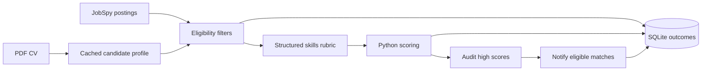

# Automated Job Data Scraping & Analysis Pipeline

A self-hosted job-discovery service that turns a CV into a structured candidate profile, evaluates scraped job postings, and sends relevant opportunities to Discord.

The current release supports one candidate profile and one application process. Scores are heuristic relevance ratings, not predictions of hiring success.

## Demonstration


Notifications provide a job link, match score, evaluation summary, missing skills, and a suggested learning action.

## Engineering highlights

- Structured LLM outputs validated with Pydantic, followed by deterministic Python score calculation.
- Concurrent language and experience checks before more expensive skills evaluation.
- A best-effort audit of high-scoring results using retained, unstripped job text.
- SQLite processing statuses and heuristic cross-platform deduplication.
- Docker Compose deployment, persistent storage, and optional Cloudflare Tunnel connectivity.

## Architecture



The diagram shows the main path, not every error branch. See [architecture and scoring](docs/architecture.md) for audit failures, retry semantics, and processing limits.

## Quick start

### Requirements

- Git and Docker Compose v2.
- OpenAI and Anthropic credentials for the configured model routes.
- A Discord webhook URL for notifications.

CV parsing and pipeline execution invoke paid external APIs. There is no cumulative daily spending cap.

### Configure and start

```bash
git clone https://github.com/ducchuu/agent-jobfetching.git
cd agent-jobfetching
cp .env.example .env
```

Fill in `OPENAI_API_KEY`, `ANTHROPIC_API_KEY`, and `DISCORD_WEBHOOK_URL`. Review the other settings in `.env.example`, including `MATCH_THRESHOLD` and optional tracing.

```bash
docker compose up -d --build
```

The intended local host binding is `127.0.0.1:8000:8000`.

### Upload a CV and request a run

```bash
curl --fail-with-body --silent --show-error \
  -X POST http://127.0.0.1:8000/upload-cv \
  -F 'file=@/path/to/resume.pdf'

curl --fail-with-body --silent --show-error \
  -X POST http://127.0.0.1:8000/trigger-pipeline

# To halt an active pipeline run prematurely:
curl --fail-with-body --silent --show-error \
  -X POST http://127.0.0.1:8000/stop-pipeline
```

These examples assume application authentication is disabled for local use. If `API_SECRET_KEY` is set, add `-H 'X-API-Key: YOUR_API_SECRET_KEY'` to protected requests (`/upload-cv`, `/trigger-pipeline`, `/stop-pipeline`, `/profile`, `/location-stats`).

```bash
curl --fail-with-body --silent --show-error \
  http://127.0.0.1:8000/pipeline-status

curl --fail-with-body --silent --show-error \
  http://127.0.0.1:8000/location-stats
```

A successful trigger response requests background execution; it does not confirm successful completion.

## Development and tests

Python 3.11 is the deployment target. The reported local test run used Python 3.12.7.

```bash
python -m venv .venv
source .venv/bin/activate
python -m pip install -r requirements.txt
python -m pytest
```

The default suite uses mocked external integrations and is intended to run without provider credentials or live API calls. The reported local result is 48 passed with three live integration tests deselected. Check [GitHub Actions](https://github.com/ducchuu/agent-jobfetching/actions) for results on the current revision.

To select live integration tests after configuring credentials:

```bash
python -m pytest -m integration
```

Live tests can incur charges. For local API development, configure `.env` and run `uvicorn app.main:app --reload`.

## Scope, security, and limitations

- One profile, one process: scheduling, locking, and live status are process-local.
- Runs are scheduled at 07:00 Europe/Amsterdam while the service is active; manual runs are also supported.
- **Multi-location round-robin pipeline**: The pipeline cycles across configured search locations (`LOCATIONS`, e.g., Netherlands, Amsterdam, Utrecht, Rotterdam, Delft). For each location, it fetches up to `MAX_RESULTS_PER_LOCATION` (capped at 1,000 to respect LinkedIn pagination limits) per day, tracked in SQLite (`location_scrape_tracking`).
- **Zero-cost early filtering**: Roles matching anti-bot pages, internship/trainee keywords in English/Dutch/Spanish (`STATUS_FILTERED_INTERN`), language requirements, or experience levels are screened out before expensive LLM skills evaluations.
- **Configurable target evaluations**: `TARGET_SKILLS_EVALUATIONS` (optional) sets a daily cap on completed skills evaluations; by default, the pipeline continues through all active locations until listings are exhausted or hit daily limits.
- Filters and audits can be wrong; inspect the original posting. The audit is best-effort and failures retain the initial result.
- The current experience policy is tailored to entry-level roles (`target_yoe=0`).
- Scraping depends on upstream sites, rate limits, and available text. Follow applicable terms and data-use requirements.
- Self-hosting does not keep all data local: profile and job text are sent to external providers.
- Configure an access boundary before enabling remote access. Cloudflare Tunnel alone does not authenticate visitors.

## Documentation

- [Release Notes v1.1.0](docs/RELEASE_NOTES_v1.1.0.md)
- [Architecture, scoring, and reliability](docs/architecture.md)
- [Deployment, access control, and maintenance](docs/deployment.md)
- [Privacy and data lifecycle](docs/privacy-and-data.md)
- [Proposed multi-user architecture — not implemented](docs/roadmap.md)

## License

Project code is provided under the [MIT License](LICENSE). Dependencies retain their respective licenses.
