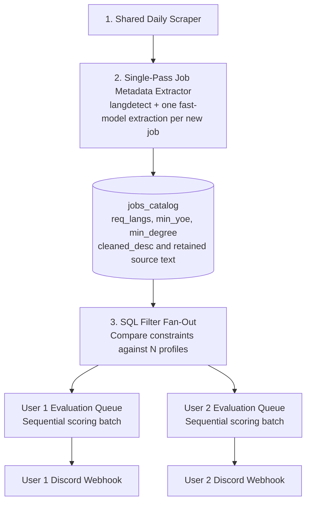

# Proposed Multi-User Architecture

[Back to README](../README.md)

> Status: future design discussion, not implemented. The released service supports one candidate profile and one application process. This document does not claim multi-user support, isolation, or measured scaling results.

## Motivation

Independent instances can repeat scraping and generic job interpretation when users search overlapping markets. Shared ingestion could amortize that work, while personalized evaluation remains user-specific.

Savings depend on overlap in searches, provider costs, and the fraction of postings surviving filters. Personalized scoring can still approach N × J calls for N users and J postings; shared ingestion does not eliminate that work.

## Proposed data flow

The proposed fast-model role corresponds to the current `gpt-6-luna` router alias; its provider mapping must remain configurable. Each user queue includes personalized scoring and any audit before notification. This is a conceptual diagram, not an implemented queue system.

## Proposed stages

### 1. Shared ingestion

Scrape the union of required search queries, deduplicate postings, and retain timestamps and source identity. Different regions, languages, and roles still require different searches. A shared morning run is one option, not a freshness guarantee.

### 2. Reusable metadata extraction

Extract explicit language, experience, degree, location, and other constraints once per new or changed posting. Store the source wording/evidence and distinguish mandatory, preferred, alternative, unknown, and conflicting requirements.

Keep retained source text alongside cleaned text. Version metadata extraction so changes to a posting or extraction policy can trigger reprocessing.

### 3. SQL/Python pre-filtering

Compare stored constraints to candidate profiles without additional LLM calls for that comparison. SQL still consumes compute and storage; this is not a measured zero-cost or microsecond guarantee.

Use conservative handling for uncertain requirements rather than converting every extracted value into an absolute rejection. Equivalent experience, alternative degrees, and negotiable conditions require policy decisions.

### 4. Per-user evaluation

Place surviving postings in durable, user-specific queues. Sequential batches with stable prompt prefixes may encourage provider-cache reuse, but do not pin a provider cache or guarantee discounts. Compare batching against latency, concurrency, fairness, and throughput requirements.

Evaluate personalized fit, audit eligible results, then dispatch to each user's configured webhook. Store outcomes by both user and posting, not just posting ID.

## Work required before implementation could ship

- Authenticated user identity, authorization, and profile isolation.
- User-scoped evaluation records, quotas, notification settings, and deletion.
- A shared jobs catalog with change detection and extraction versioning.
- Durable queue claims, retries, backoff, and failure states.
- Idempotent delivery strategy and separate notification status.
- Per-user spending limits and fair scheduling.
- Secret handling for user-specific webhooks and credentials.
- Shared scheduler/worker coordination; reassess database choice using measured workload.
- Tests proving one user cannot read or modify another user's data.
- Evaluation of false-negative rates introduced by metadata pre-filtering.
- Privacy and retention policies for shared job text and private profiles.

## Questions to validate first

1. How much overlap exists across real users' search queries?
2. Does shared extraction cost less than the filtering work it replaces?
3. How often do metadata rules reject a relevant posting?
4. What throughput and latency are actually required?
5. How are changed postings, profiles, and evaluation policies re-evaluated?

A small measured prototype should answer these questions before replacing the single-profile implementation.
